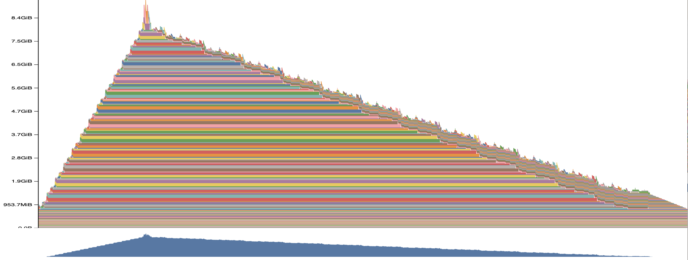
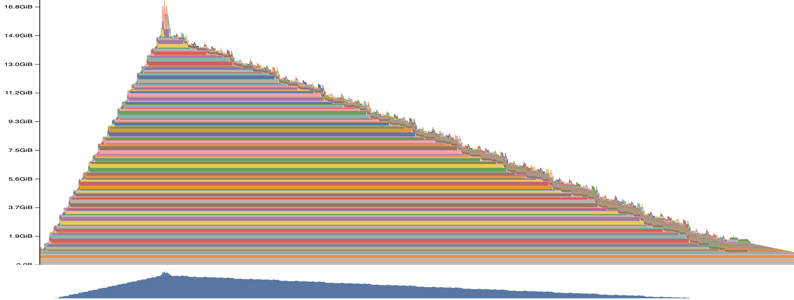
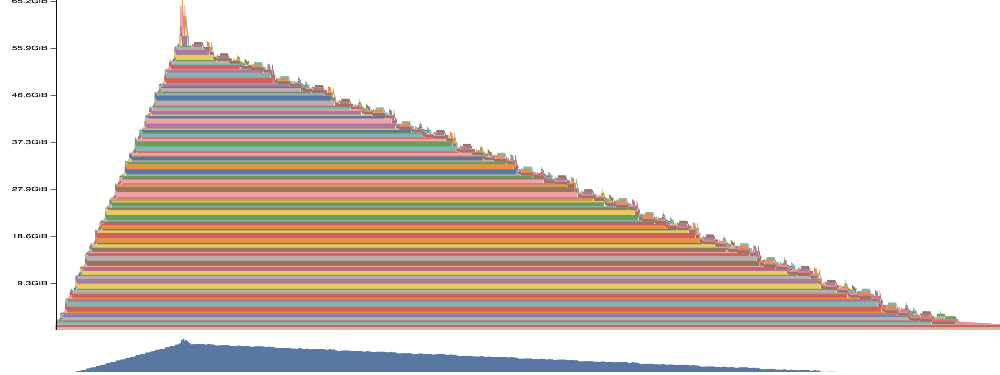
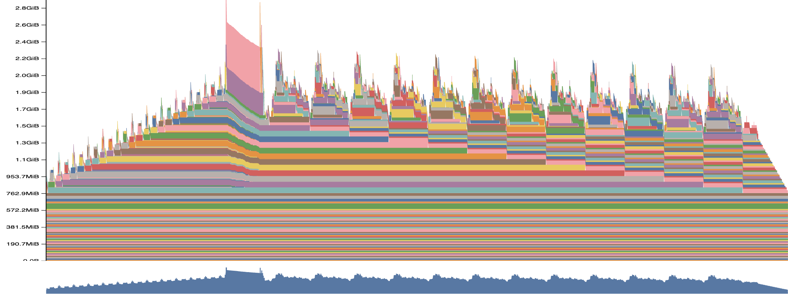
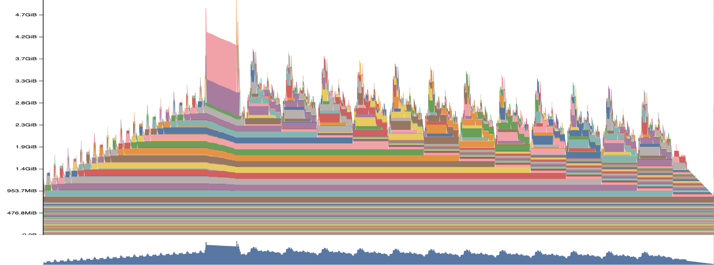
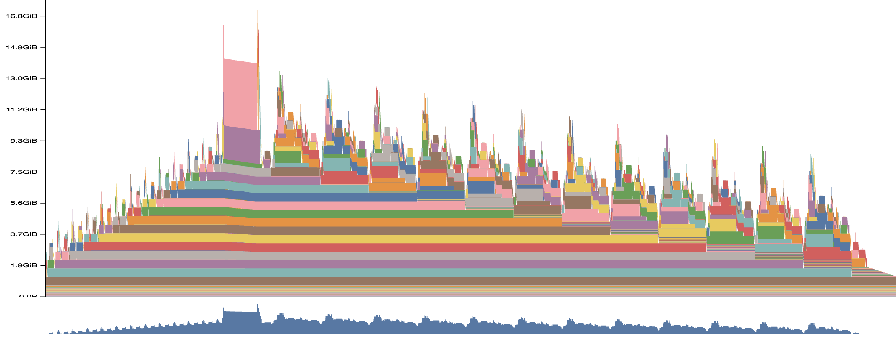
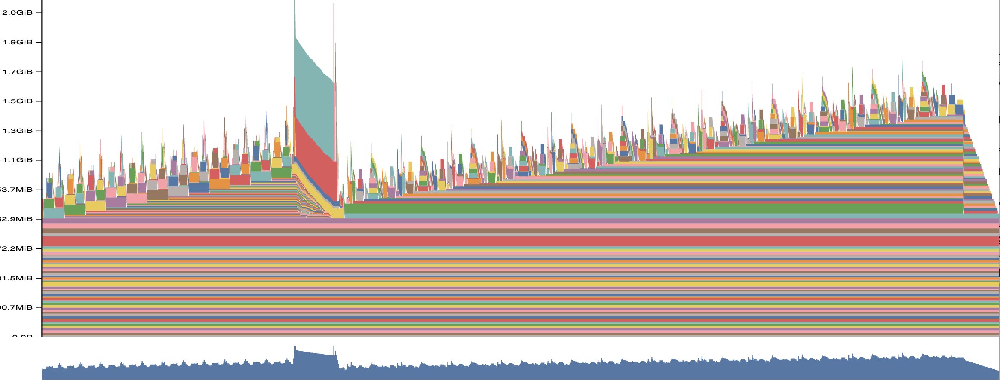
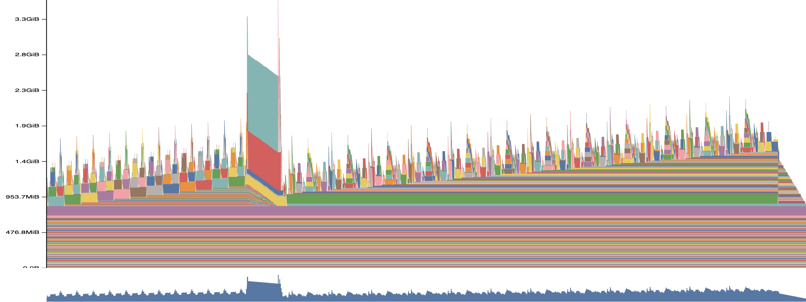
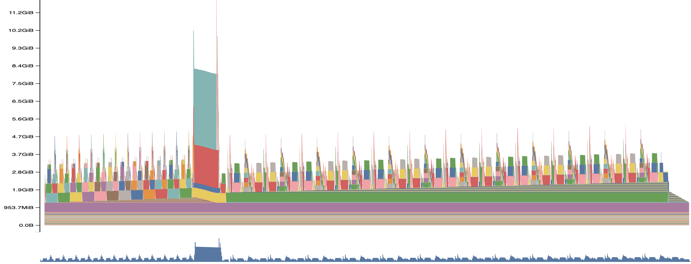

# Activation checkpointing.

Activation checkpointing - метод оптимизации памяти при обучении глубоких нейросетей, который жертвует дополнительным временем вычислений ради значительного сокращения использования памяти (RAM/VRAM).

Для реализации подхода была выбрана следующая архитектура трансформера:
```text
Transformer (GPT-like, decoder-only, pre-LN), Linear-слои без bias
├── tok_emb: Embedding(8192, 1024)
├── pos_emb: Embedding(seq_len, 1024)                  # обучаемые позиции
├── blocks: 12 × Block
│   ├── x = x + Attention(LayerNorm(x))
│   │     qkv: 1024 → 3072, 16 голов, SDPA(is_causal=True) (flash attention), proj: 1024 → 1024
│   └── x = x + MLP(LayerNorm(x))
│         fc: 1024 → 4096, GELU, proj: 4096 → 1024
├── ln_f: LayerNorm(1024)
└── lm_head: Linear(1024, 8192) → cross-entropy

≈168M параметров + seq_len × 1024 в pos_emb; обучение в bf16 autocast, batch = 1.
Checkpointing и offload применяются к каждому из 12 блоков.
```

## Код и запуск
Для начала подготовьте окружение: torch ≥ 2.4 и CUDA GPU (других зависимостей нет). Для запуска необходимо выполнить команду
```bash
conda activate venv
python bench.py --seq-len 16384 --steps 1 --gpu 0
```
Параметр `seq-len` отвечает за длину последовательности, которая будет обрабатываться. Для более явного эффекта рекомендуется работать с контекстом в 10k+ токенов. Параметр `steps` отвечает за число шагов обучения (forward + backward), которые записывает профайлер скорости. Перед ними выполняются ещё два шага: один пропускается, второй идёт на прогрев. По умолчанию `steps = 3`, в таблице ниже время усреднено по этим трём шагам. Параметр `gpu` отвечает за индекс карты, на которой будет запуск.

Проверка корректности: `python bench.py --check`. Она сравнивает loss и все градиенты трёх режимов (dropout = 0.1, fp32).

Для каждого режима (`baseline`, `ckpt`, `offload`) в `results/` сохраняются:
- `{mode}_T{seq_len}.pickle`: снимок памяти одного шага, открывается на https://pytorch.org/memory_viz;
- `{mode}_T{seq_len}.json`: трейс профайлера.

## Анализ результатов
Были проведены эксперименты с последовательностями длины 16384, 32768, 131072.
| Sequence length | Baseline peak | Checkpoint peak | Offload peak | Checkpoint saving | Offload saving |
|---:|---:|---:|---:|---:|---:|
| 16 384 | 9.16 GiB | 2.89 GiB | 2.14 GiB | **68.4%** | **76.6%** |
| 32 768 | 17.33 GiB | 5.02 GiB | 3.52 GiB | **71.0%** | **79.7%** |
| 131 072 | 66.36 GiB | 17.96 GiB | 11.96 GiB | **72.9%** | **82.0%** |

Время одного шага обучения (forward + backward) по GPU-таймлайну трейса, среднее по 3 шагам:

| Sequence length | Baseline step | Checkpoint step | Offload step | Checkpoint overhead | Offload overhead |
|---:|---:|---:|---:|---:|---:|
| 16 384 | 123.5 ms | 159.3 ms | 434.3 ms | **+29.0%** | **+251.7%** |
| 32 768 | 397.0 ms | 507.8 ms | 978.8 ms | **+27.9%** | **+146.5%** |
| 131 072 | 5 320 ms | 7 052 ms | 7 640 ms | **+32.6%** | **+43.6%** |

- **Checkpoint.** Forward не меняется (37.4 → 37.5 ms при T = 16k), а backward дорожает ровно на один forward (86.0 → 121.8 ms). Это и есть пересчёт блоков.
- **Offload.** Чистое время вычислений на GPU почти такое же, как у baseline (128 vs 122 ms при T = 16k). Остальное время GPU ждёт копирования активаций GPU → CPU в forward и CPU → GPU в backward. Объём копий растёт линейно по T, а attention ~T², поэтому доля копирования падает с ростом контекста.

Наблюдаемое поведение:
- baseline: forward $\rightarrow$ память ступенчато растёт $\rightarrow$ достигается максимум $\rightarrow$ backward $\rightarrow$ сохранённые активации освобождаются слой за слоем;
- activation checkpointing (исчезает накопление внутренних активаций блоков): характерные повторяющиеся зубцы объясняются тем, что в этом случае происходит recompute block $\rightarrow$ временно создать его activations $\rightarrow$ выполнить backward $\rightarrow$ освободить их $\rightarrow$ перейти к следующему block;
- CPU offload (минимальная VRAM, проигрываем по скорости из-за переноса данных): постоянный GPU footprint заметно ниже, а поверх него возникают короткие spikes, когда активации возвращаются CPU → GPU для backward. 

Offloading очень дорог на относительно короткой текстовой последовательности, но как только она становится длиннее overhead уменьшается. 

Active Memory Timeline одного шага (memory_viz):

| | T = 16 384 | T = 32 768 | T = 131 072 |
|---|:---:|:---:|:---:|
| **baseline** | <a href="assets/baseline_T16384.png"></a> | <a href="assets/baseline_T32768.png"></a> | <a href="assets/baseline_T131072.png"></a> |
| **ckpt** | <a href="assets/ckpt_T16384.png"></a> | <a href="assets/ckpt_T32768.png"></a> | <a href="assets/ckpt_T131072.png"></a> |
| **offload** | <a href="assets/offload_T16384.png"></a> | <a href="assets/offload_T32768.png"></a> | <a href="assets/offload_T131072.png"></a> |

Из графиков видно, что после того как активации блоков почти убраны из VRAM, узким местом по памяти становится уже не сам Transformer, а выходная проекция и cross-entropy:
- у ckpt и offload пик достигается не во время пересчёта блоков, а в узком высоком выбросе сразу после forward. Именно тогда считаются логиты `T × V` и их fp32-копии в cross-entropy;
- разница пиков ckpt и offload равна 0.75 / 1.50 / 6.00 GiB, т.е. ровно 12 сохранённым входам блоков (12 × T × 1024 × 4 B). Всё остальное у двух методов общее.

